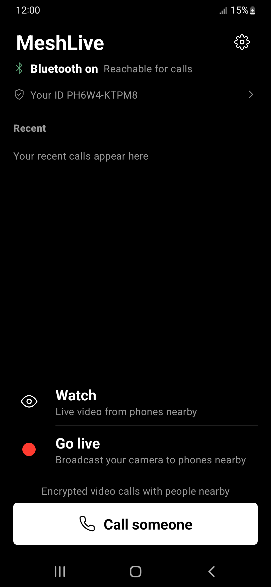
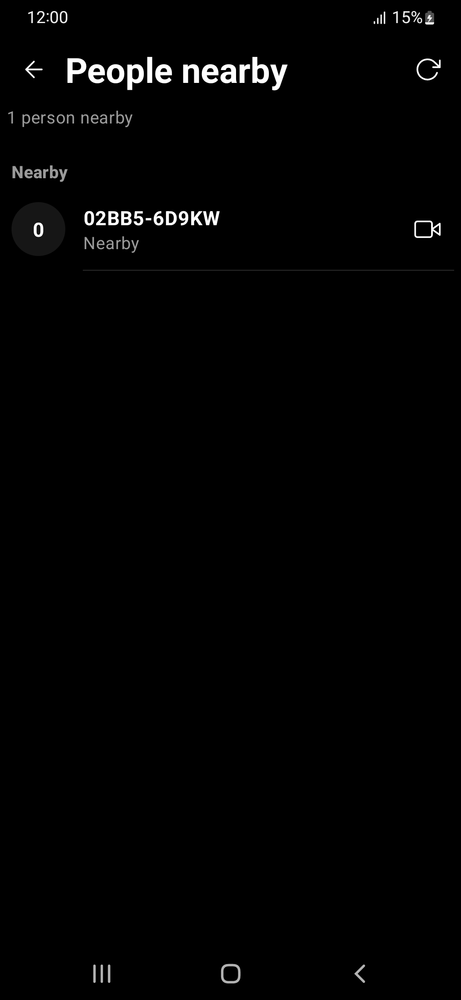
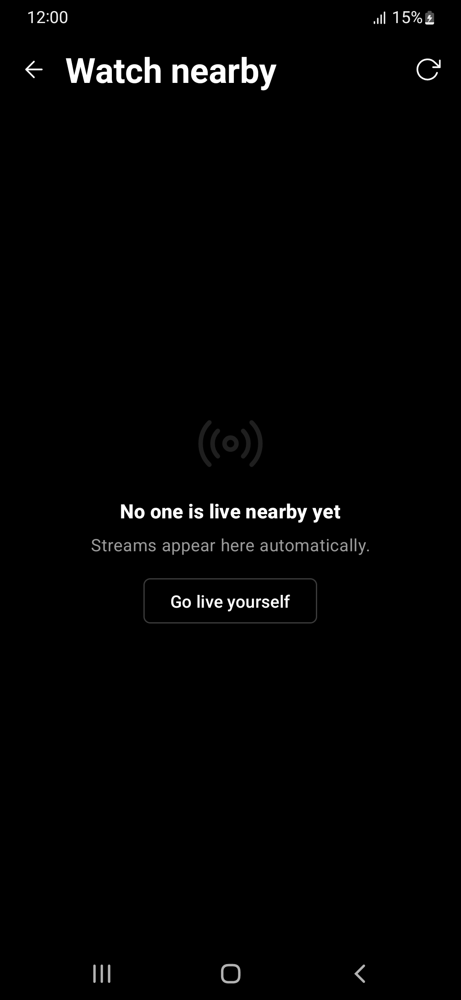
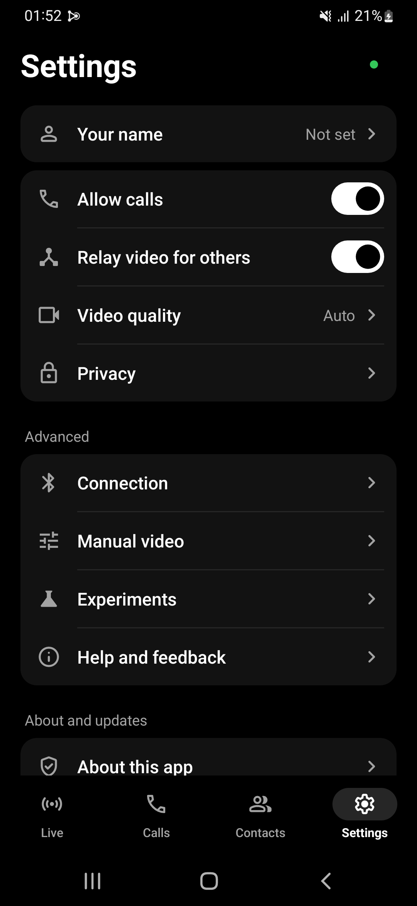
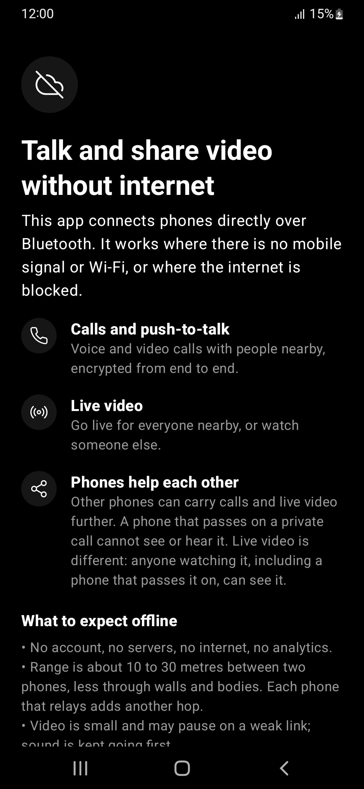

# MeshLive

**Decentralized, encrypted video calls and live streams over a Bluetooth mesh. No internet needed.**

<p align="center">
  <a href="https://github.com/MeshLive/meshlive-android/releases/latest/download/MeshLive.apk"></a>
  &nbsp;
  <a href="https://apps.obtainium.imranr.dev/redirect?r=obtainium://add/https://github.com/MeshLive/meshlive-android"></a>
</p>

<p align="center">Android 10 or newer · free · no account · <a href="#install">How to install</a></p>

<p align="center">
  <a href="https://scorecard.dev/viewer/?uri=github.com/MeshLive/meshlive-android"></a>
  <a href="https://github.com/MeshLive/meshlive-android/actions/workflows/codeql.yml"></a>
</p>

<p>
  
  
  
  
  
</p>

## What it does

- Make private **video and voice calls** with someone nearby.
- **Stream live** from your camera. People around you can watch.
- **Phones pass the signal along.** Each phone can relay to the next, so a call or stream reaches people who are out of range of the source. That chain of phones is the "mesh".
- Everything is **end-to-end encrypted**. Only the people in the call or stream can see or hear it.
- It needs **no internet, SIM card, account or server.**
- It is **free and open source** (GPL-3.0).

It is built for blackouts, disasters, censorship, remote areas and crowded events.

## How it works

Your phone talks to nearby phones over Bluetooth, so the network is never involved. A phone that watches a stream can pass it on to other phones, and they can pass it on again. Each phone only deals with the phone it gets the stream from and the phones it sends to. Bluetooth is slow, so expect small, delayed video that gets weaker with each hop.

```
 Source phone ))) Viewer phone ))) Viewer phone ))) ...
     (camera)     (also relays)    (also relays)
```

## Privacy

Phones that are nearby can see that MeshLive is running. The app hides who you are:

- The ID your phone broadcasts is random and changes every 15 minutes, so a passive listener cannot follow you.
- Calls hide both identities from anyone listening in.
- A stranger sees a throwaway identity until you accept their call. Your contacts recognise you.

The limits, stated plainly:

- A live stream shows its source to everyone who watches.
- On Android 13 and older, a phone that connects to yours can read its Bluetooth name.
- Classic Bluetooth (an older, faster mode) shows a permanent hardware address.
- Anyone whose call you accept learns who you are.
- Nobody outside the project has audited the security.

Details and measurements: [docs/PRIVACY.md](docs/PRIVACY.md).

## Install

1. On your phone, tap **[Download MeshLive](https://github.com/MeshLive/meshlive-android/releases/latest/download/MeshLive.apk)**.
2. Open the file. If Android asks, allow your browser to **install unknown apps**, then tap **Install**.
3. Open MeshLive and allow **Nearby devices**, **Camera** and **Microphone**.

Both people need MeshLive. To get updates automatically, add the project in [Obtainium](https://github.com/ImranR98/Obtainium) with the button above. With no internet, a friend can send you the app: in MeshLive, Help, then **Share this app**. The app can also check for updates, but only if you say yes.

To check a download is genuine, see [how to verify a release](docs/USER_GUIDE.md#verifying-a-release). Other install options, the file list, features and common questions are in the [user guide](docs/USER_GUIDE.md).

## Status

MeshLive is in **beta**. It has been tested on seven phones from Samsung, Xiaomi, ASUS and OPPO, running Android 10 to 16. Results vary by phone pair, so see [docs/DEVICES.md](docs/DEVICES.md). Do not rely on it where your safety depends on it.

**Please report your phone.** The [device report form](https://github.com/MeshLive/meshlive-android/issues/new?template=device-report.yml) takes two minutes. Reports where everything worked help as much as failures.

## Build from source

You need JDK 21, the Android SDK with NDK `28.2.13676358` and CMake `3.22.1`, Perl and Python 3.11 or newer.

```bash
python tools/fetch_native_sources.py   # downloads the pinned libaom and libopus
./gradlew :app:testDebugUnitTest :app:assembleGithubDebug
```

The APK is `app/build/outputs/apk/github/debug/app-github-debug.apk`. Developers can read [docs/ARCHITECTURE.md](docs/ARCHITECTURE.md) (how it is built, build notes, the list of experimental switches) and [docs/PROTOCOL.md](docs/PROTOCOL.md) (wire formats and security rules). Test results are in [MeshLive/meshlive-benchmarks](https://github.com/MeshLive/meshlive-benchmarks).

## Documentation

| I want to... | Read |
| --- | --- |
| Install, update, verify, use the app, get answers | [docs/USER_GUIDE.md](docs/USER_GUIDE.md) |
| Know what is exposed and what is hidden | [docs/PRIVACY.md](docs/PRIVACY.md) |
| See which phones work | [docs/DEVICES.md](docs/DEVICES.md) |
| Understand how it is built, and the experimental switches | [docs/ARCHITECTURE.md](docs/ARCHITECTURE.md) |
| Implement or review the wire format and security rules | [docs/PROTOCOL.md](docs/PROTOCOL.md) |
| See what is unfinished | [docs/PLAN.md](docs/PLAN.md) |
| Test on phones, or read why a measured choice was made | [docs/TESTING.md](docs/TESTING.md), [docs/DECISIONS.md](docs/DECISIONS.md) |
| Contribute, or follow the rules for coding agents | [CONTRIBUTING.md](CONTRIBUTING.md), [AGENTS.md](AGENTS.md) |

## Contributing

Bug reports, device results, documentation and code are welcome. Start with [CONTRIBUTING.md](CONTRIBUTING.md). Please follow the [code of conduct](CODE_OF_CONDUCT.md).

## Security

Report vulnerabilities privately through [GitHub private vulnerability reporting](https://github.com/MeshLive/meshlive-android/security/advisories/new). See [SECURITY.md](SECURITY.md).

## How this was built

Most of the code was written with AI assistance (Anthropic's Claude), directed by the maintainer, who decides what the app does and tests it on real phones. It has not had an independent security audit.

## License

GPL-3.0-or-later. See [LICENSE](LICENSE) and [THIRD_PARTY_NOTICES.md](THIRD_PARTY_NOTICES.md).
