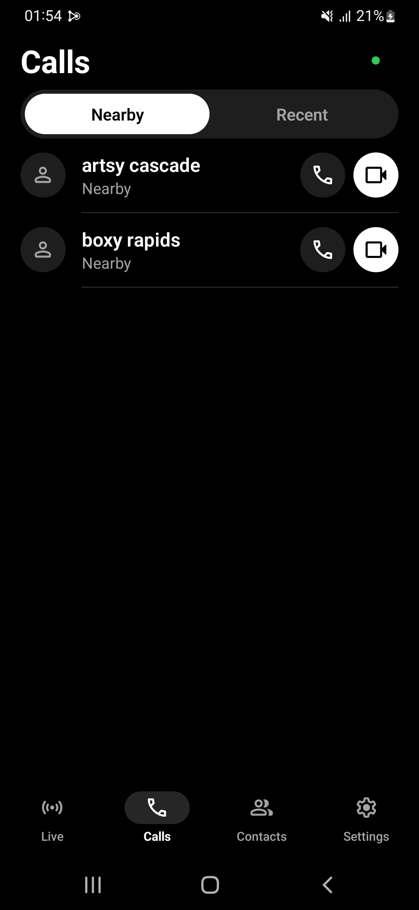
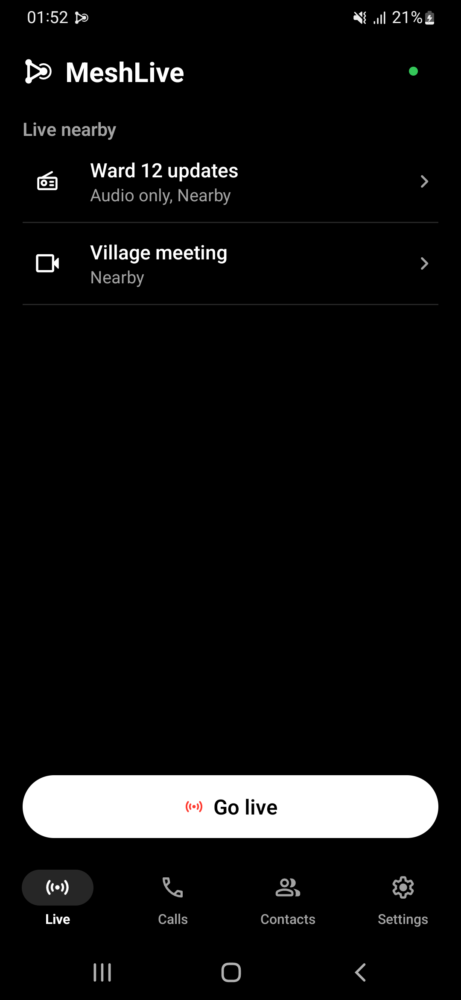
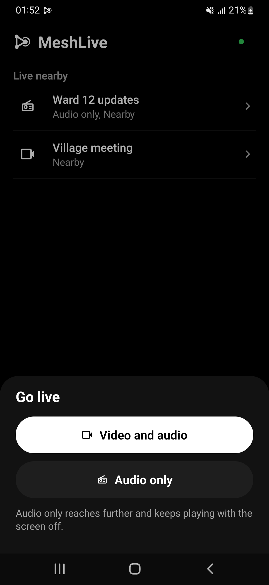
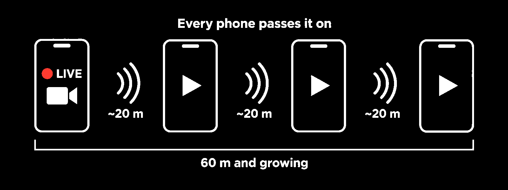

# MeshLive

Calls, chats and livestreams over a Bluetooth mesh. 
Every phone passes it on, so you reach further than Bluetooth alone. 
No internet, no SIM, no account.

 

  
  
  
  
  

&nbsp;

Free · open source · <a href="docs/user-guide.md#install">How to install</a>

 
 

## What it does

<table>
<tr>
<td width="50%" valign="top">

**Calls**
- Voice and video calls with people nearby
- End-to-end encrypted, phone to phone
- Missed calls, call back, block unknown callers

**Livestream**
- Go live and share your camera with everyone around you
- Audio only, like a local radio that keeps playing with the screen off
- Phones in between pass your stream along

</td>
<td width="50%" valign="top">

**Contacts**
- Add people by scanning each other's code
- Call them from Contacts whenever they're nearby
- Strangers only see a random name that changes every 15 minutes

**Your privacy**
- No internet, SIM, account or server
- Your calls never touch the internet
- Delete everything from the phone in seconds

</td>
</tr>
</table>

Works wherever there's no signal or Wi-Fi, like hikes, festivals, trips and basements. MeshLive is in **beta**: see [which phones work](docs/devices.md), and don't rely on it where your safety depends on it.

## How it works

Bluetooth on its own reaches about 10 to 30 metres. MeshLive turns every phone running it into a relay: your livestream or call hops from phone to phone, so the more people around you use MeshLive, the further you reach.

  

- **Livestreams** pass from phone to phone: everyone watching can also pass it on to the next people.
- **Calls** go straight to the other phone, or through phones in between when they are out of range (beta).
- Nothing touches the internet. Each hop adds a little delay and Bluetooth is slow, so video is small; audio-only streams reach the furthest.

## Download

| Platform | Status |
| --- | --- |
| Android 10+ | Available: [GitHub releases](https://github.com/MeshLive/meshlive-android/releases/latest), [Obtainium](https://apps.obtainium.imranr.dev/redirect?r=obtainium://add/https://github.com/MeshLive/meshlive-android) |
| Windows | Beta: [GitHub releases](https://github.com/MeshLive/meshlive-windows/releases/latest) (unsigned zip) |
| iPhone and Mac | Source build: [meshlive-apple](https://github.com/MeshLive/meshlive-apple) (Mac app experimental; iPhone not yet tested on hardware) |

## Privacy

No accounts, no ads, no analytics, no servers. Calls and streams are encrypted, and your real name is only sent, encrypted, to the people you choose. What nearby phones can and can't see is explained in [Privacy](docs/privacy.md).

## Documentation

### For users

| Document | What it covers |
| --- | --- |
| [User guide](docs/user-guide.md) | Install, update and verify the app, use it, common questions |
| [Privacy](docs/privacy.md) | What nearby phones can see, what is hidden, and the known limits |
| [Supported phones](docs/devices.md) | Which phones have been tested and how it went; report yours |

### For contributors

| Document | What it covers |
| --- | --- |
| [Contributing](CONTRIBUTING.md) | How to report a bug or a device result and send a change |
| [Building](docs/dev/building.md) | Build and test from source |
| [Architecture](docs/dev/architecture.md) | How the app is built: modules, radio links, pipelines, relays, calls |
| [Protocol](docs/dev/protocol/README.md) | Wire formats and security rules, by topic, with a reading order |
| [Switches](docs/dev/switches.md) | The register of experimental, alternative and optional switches |
| [Run the tests](docs/dev/testing.md) | Quick start: build, unit and tool tests, one workflow check on your phones |
| [Testing reference](docs/dev/testing-reference.md) | Test scope, acceptance gates and the full phone test workflow |
| [Decisions](docs/dev/decisions/README.md) | Why measured choices were made, and the design records, one page each |
| [Roadmap](docs/dev/roadmap.md) | Unfinished work |
| [Working rules](AGENTS.md) | Rules for people and coding agents who change the code |
| [Security](SECURITY.md) | Report a vulnerability privately |
| [Code of conduct](CODE_OF_CONDUCT.md) | How we treat each other |

## Contributing

Bug reports, device results, translations and code are welcome. Start with [CONTRIBUTING.md](CONTRIBUTING.md), and please follow the [code of conduct](CODE_OF_CONDUCT.md). Report security issues privately: see [SECURITY.md](SECURITY.md). MeshLive has not had an independent security audit yet.

## License

GPL-3.0-or-later. See [LICENSE](LICENSE) and [THIRD_PARTY_NOTICES.md](THIRD_PARTY_NOTICES.md).

## Star history

<a href="https://star-history.com/#MeshLive/meshlive-android&Date">
  <picture>
    <source media="(prefers-color-scheme: dark)" srcset="https://api.star-history.com/svg?repos=MeshLive/meshlive-android&type=Date&theme=dark" />
    
  </picture>
</a>

